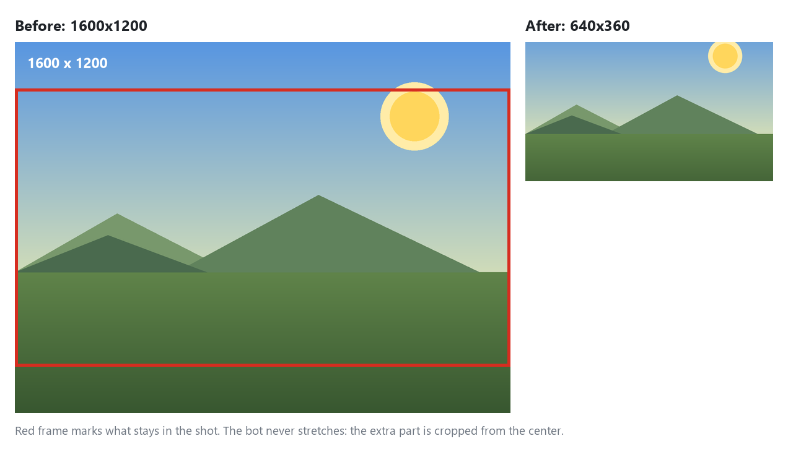

# Telegram Image Resize Bot — 640×360

A Telegram bot in Python: it takes any photo and returns it as a **640×360 (16:9)**
image — proportions kept, center cropped, never stretched.



**No tokens in this repository.** The bot reads its token from the `BOT_TOKEN`
environment variable — put your own value there. `.env` is listed in `.gitignore`,
so your keys stay on your machine. The script also refuses to start on a value
that does not look like a Telegram token, and never prints it.

## Where these images go — and why 640×360

640×360 is exactly 16:9: the same frame as 1280×720 and 1920×1080, only smaller.
That ratio is what most layouts ask for, so one pass through the bot gives you a
picture that fits without hand-cropping.

| Where the image is used | Why 16:9 / 640×360 fits |
| --- | --- |
| Service and product cards on a website | cards are 16:9 blocks — equal heights, no jumping rows |
| Blog and article covers | the cover shows fully; the layout does not cut it |
| Video thumbnails, 360p previews | 640×360 is the standard small frame for 16:9 video |
| Ad creatives (Yandex Direct, VK, Meta) | most placements ask for 16:9 or 1.78 |
| Slides, presentations, price lists | one picture size for the whole deck |
| Catalogues and galleries | thumbnails line up instead of "breathing" |

### Examples

- **Ten photos for a services page.** In an editor that is ten manual crops; here you
  forward the photos to the bot and get ten files of the same size, ready to drop in.
- **One photo, three places.** The same shot goes to a website card, a post preview and
  a presentation slide — all 16:9, all the same weight on the page.
- **From a phone, on site.** The photos were taken on a phone at the object, and the
  catalogue needs them before you are back at the laptop.
- **A tall photo.** A 1600×1200 shot loses 12.5% from the top and the bottom and keeps
  the middle — an honest frame instead of a squeezed picture.
- **Mixed sources.** Photos from a camera, a phone and a messenger screenshot all come
  out the same size, so a grid of cards looks tidy.

## What it does

| Step | What happens |
| --- | --- |
| 1 | You send the bot a photo |
| 2 | The bot fits it into a 640×360 frame, keeping the proportions |
| 3 | The extra part is cropped from the center; the PNG comes back as a reply |

Works in private chats: `/start`, then any photo.

## Install

Python 3.10 or newer.

```bash
git clone https://github.com/it-bas-shuravi/resize-img-mx-bot.git
cd resize-img-mx-bot

python -m venv .venv
# Windows:
.venv\Scripts\activate
# Linux / macOS:
source .venv/bin/activate

pip install -r requirements.txt
```

## Environment variables

| Variable | Required | What it is |
| --- | --- | --- |
| `BOT_TOKEN` | yes | bot token from [@BotFather](https://t.me/BotFather) |

Copy the template and put in **your own** token:

```bash
cp .env.example .env
# open .env and set BOT_TOKEN=<your token>
```

`.env` is in `.gitignore` and never reaches the repository — your keys stay local.

## Run

```bash
python bot.py
```

The console prints `Бот запущен, жду фото`. Open the bot in Telegram, send `/start`
and then any picture.

## Structure

```
bot.py             — bot logic: receive a photo, resize, reply
requirements.txt   — dependencies
.env.example       — environment variable template (no values)
docs/demo.png      — before/after example produced by this code
```

## Notes

- Bot replies are in Russian — change them in `start()` and `photo_handler()`.
- No telemetry and no third-party APIs: the image is processed locally with Pillow.
- The example image in `docs/` was generated by the bot's own `resize_to_target()`,
  not retouched by hand.

## License

MIT — see [LICENSE](LICENSE).

---

## По-русски

Telegram-бот на Python: принимает любое фото и возвращает картинку **640×360 (16:9)** —
пропорции сохраняются, лишнее обрезается по центру, без растягивания.

**Ключей в репозитории нет.** Токен бот берёт из переменной окружения `BOT_TOKEN` —
свой вписываете сами, файл `.env` в `.gitignore` и в репозиторий не попадает.
Если значение не похоже на токен Telegram, бот просто не запустится — и никогда
не печатает сам токен.

### Куда идут такие картинки

640×360 — это ровно 16:9, тот же кадр, что 1280×720 и 1920×1080, только меньше.
Такой формат просят почти все вёрстки:

| Куда | Почему 16:9 / 640×360 подходит |
| --- | --- |
| Карточки услуг и товаров на сайте | карточка — блок 16:9: ряды ровные, высота не «прыгает» |
| Обложки статей в блоге | обложка видна целиком, вёрстка её не режет |
| Превью видео, кадр 360p | 640×360 — стандартный маленький кадр для 16:9 |
| Баннеры в рекламных кабинетах | большинство площадок просят 16:9 или 1.78 |
| Слайды, презентации, прайсы | один размер картинки на всю презентацию |
| Каталоги и галереи | миниатюры выстраиваются в линию, а не «дышат» |

### Примеры

- **Десять фото для страницы услуг.** В редакторе это десять ручных обрезок; здесь
  пересылаешь фото боту и получаешь десять файлов одного размера — можно сразу вставлять.
- **Одно фото — три места.** Одна и та же картинка идёт в карточку на сайте, в превью
  поста и в слайд презентации: везде 16:9 и одинаковый вес на странице.
- **С телефона, на объекте.** Фото сняты на телефон, а каталог ждёт их «сегодня».
- **Высокое фото.** Кадр 1600×1200 теряет по 12,5% сверху и снизу и сохраняет середину —
  это честнее, чем сплющенная картинка.
- **Разные источники.** Фото с камеры, с телефона и скриншот из мессенджера выходят
  одного размера — сетка карточек выглядит аккуратно.

### Как поставить

Нужен Python 3.10 или новее:

```bash
git clone https://github.com/it-bas-shuravi/resize-img-mx-bot.git
cd resize-img-mx-bot
pip install -r requirements.txt
cp .env.example .env        # и впишите свой BOT_TOKEN от @BotFather
python bot.py
```

В консоли появится `Бот запущен, жду фото` — дальше `/start` и любая картинка.
